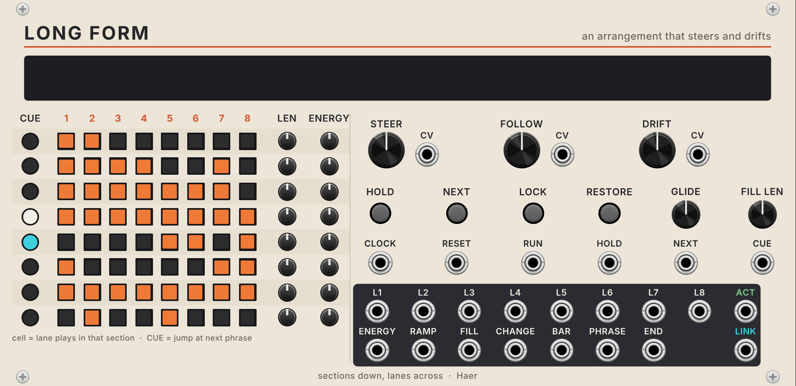
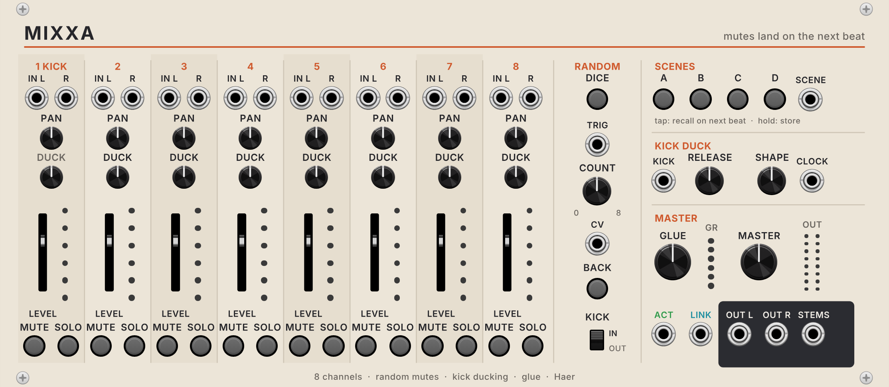

# Long Form + Mixxa

Two VCV Rack 2 modules by Haer for playing a whole track instead of a loop.

- **Long Form** (52 HP) is an arrangement conductor. You draw a song form on an 8 × 8 grid (sections down, lanes across), and it tells everything else when to come in, drop out and build. **STEER** picks the energy you want next, and **DRIFT** lets the form rewrite itself a little after each section.
- **Mixxa** (58 HP) is an 8-channel performance mixer. Every mute, solo, scene change and random roll lands on the **next beat**. It also has kick ducking and a one-knob glue compressor.

One poly cable (**LINK**) joins them.

## Install (Apple Silicon Mac)

1. Download `LongFormMixxa-2.1.0-mac-arm64.vcvplugin` from the [latest release](https://github.com/hardyfinn/LongForm-Mixxa/releases/tag/latest).
2. In Rack, choose **Help → Open user folder**, then close Rack.
3. Put the file, unopened, into the `plugins-mac-arm64` folder.
4. Start Rack and search for **Long Form** or **Mixxa**.

## First patch

1. Clock (16th notes, from Live via CV Tools and the disting NT, or VCV Clocked) into Long Form **CLOCK**, and the clock's reset into **RESET**.
2. Long Form **LINK** → Mixxa **LINK**.
3. Your parts into Mixxa: kick on 1, then bass, hats, clap, perc, chords, lead and texture on 2 to 8.
4. Mixxa **OUT L / R** to your audio interface.
5. Press play. The default form (Intro 16, Groove 32, Build 8, Peak 32, Break 16, Drop 8, Peak 2 32, Outro 16) runs about 6 minutes at 130 BPM, bringing parts in and out.

Starting values: DUCK about 60% on bass and chords, RELEASE 160 ms, GLUE at 9 o'clock.

## Long Form

| Control | What it does |
| --- | --- |
| Grid cells | Click to switch a lane on or off in that section. Orange = plays |
| CUE (left column) | Cue that section: it starts on the next 4-bar line (menu: 1, 2, 4 or 8). Click again to cancel |
| LEN | Section length: Off, 1, 2, 4, 8, 12, 16, 24, 32, 48 or 64 bars. Off skips the row |
| ENERGY | 0 to 10, sent out as 1 V per step |
| STEER + CV | The energy you want next. Used when FOLLOW lets Long Form choose |
| FOLLOW + CV | 100% plays the rows in order. Lower lets it pick any row, weighted by how close its energy is to STEER |
| DRIFT + CV | Chance that, when a section ends, one small edit is made for next time: a lane in or out, length halved or doubled (4 to 64 bars), two neighbouring sections swapped, or energy ±1 |
| HOLD (button and gate) | Repeat this section |
| NEXT (button and trigger) | Move on at the next bar line |
| LOCK | No drift edits |
| RESTORE | Undo every drift edit (your drawn form comes back) |
| GLIDE | Energy output slides over 0 to 8 bars |
| FILL LEN | How long the FILL gate is: ½, 1, 2 or 4 bars |
| RUN | Counts only while high (unpatched: always) |
| CUE input | 0 to 8 V picks a row (1 V each) |

Outputs: **L1 to L8** lane gates, **ACT** (poly 8, 10 V = play; channels 1 to 6 match Francois Markovian's A to F), **ENERGY**, **RAMP** (0 to 10 V over each section), **FILL**, **CHANGE**, **BAR**, **PHRASE** (every 4 bars; menu 2 to 16), **END**, **LINK**.

Drift-edited cells show a small amber dot, and the cell flashes as the edit happens. The display shows the form as blocks (width = length, brightness = energy), the playhead, the cued section in cyan, and the last drift edit. Drift is seeded and saved with the patch, so a patch replays the same drift; right-click for a new seed.

Right-click: clock rate (16ths, 24 PPQN, 8ths, quarters), cue grid, phrase length, loop or stop at the end, section and lane names, new drift seed, clear the grid.

## Mixxa

**Next-beat mutes.** Press MUTE and it blinks orange: the change is armed. On the next beat it happens. Press again before the beat to cancel. SOLO works the same way. Each mute fades over 4 ms (menu: 2 to 20 ms). Right-click **Mute timing** for next beat (default), next 16th or immediate. With no clock at all, mutes act at once.

MUTE colours: blinking orange = armed, red = muted, amber = you have overridden Long Form (it hands the channel back at the next section change, unless **Manual mutes stay** is on).

**Scenes A to D.** Hold a scene button for 1 second to store the current mutes. Tap to recall on the next beat. SCENE CV: 0 to 4 V picks A to D.

**Random mutes** (after Tiny Tricks' Random Mute x8; written from scratch here). DICE or a trigger at TRIG mutes COUNT random channels on the next beat and unmutes the rest. Only channels with an input count, and channels Long Form has muted are left alone. COUNT CV adds -5 to +5 V → 0 to 8, as in Random Mute x8. BACK returns to the mutes from before the last roll. The **KICK IN/OUT** switch decides whether channel 1 can be picked (default IN); right-click to leave out any of channels 2 to 8. "Always a new set" (on by default) re-rolls if a roll would repeat the current set.

**Kick ducking.** KICK takes a trigger or the kick's audio; unpatched, channel 1's audio is used. Each channel's DUCK sets the depth (channel 1 never ducks). RELEASE: 40 to 400 ms. SHAPE: gate-like, pump (noon), smooth swell.

**Master.** GLUE is a 2:1 bus compressor (10 ms attack, 150 ms release, soft knee) with up to about 4 dB of gain reduction and automatic make-up. MASTER is the output level (0 dB at about 1 o'clock, +6 dB at full). STEMS is poly 16: channels 1 to 8 left, 9 to 16 right, post-fader and post-mute.

**Inputs.** CLOCK (16ths; ignored when LINK is patched), ACT (poly 8: 10 V = play, quantised to the beat), LINK.

## LINK cable

| Channel | Carries |
| --- | --- |
| 1 to 8 | Lane gates (10 V = play) |
| 9 | Beat trigger |
| 10 | Section change trigger |
| 11 | Energy (0 to 10 V, with glide) |
| 12 | Reset trigger |
| 13 | 16th-note trigger (for Mixxa's "next 16th" timing) |
| 14 | Section number: 0 V = row 1 to 7 V = row 8 (for The Changes, which keeps a chord loop per section) |

## Build

    make RACK_DIR=<Rack SDK>                 # plugin
    c++ -std=c++11 -O2 -o test/engine_test test/engine_test.cpp && test/engine_test
    python3 res/make_panels.py               # res/*.svg and src/Layout.hpp (needs fonttools)

GitHub Actions builds the mac-arm64 plugin on every push and publishes it to the `latest` release.

Licence: GPL-3.0-or-later.
